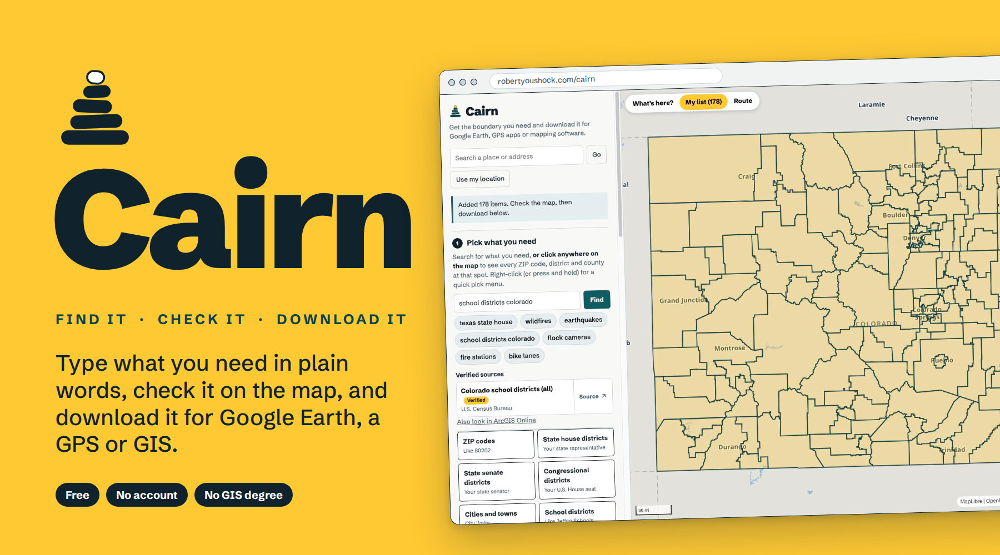

## Hi, I'm Robert

**Creative technologist in Denver, working where motion, maps and code meet.**

I blend motion, UX/UI, and emerging technologies to craft story-driven visuals. I've spent six years in design, from broadcast graphics to data visualization, turning complex ideas into design that's intuitive and has impact. Today I'm an Emerging Technologies Designer at TEGNA.

**On this page:** [Projects](#projects) · [What I work with](#what-i-work-with) · [Elsewhere](#elsewhere)

---

### Projects

<table>
<tr>
<td width="46%">

</td>
<td>

**[Our Places](https://github.com/robertyoushock/our-places-showcase)**

A phone-first web app for two people to keep a top 10 in every food category, plus a wish list of places to try. It has a map, offline mode, drag to re-rank, and Spotify Wrapped-style story cards.

Vanilla JS · Cloudflare Pages + D1 · MapLibre · $0 a month

[Project page](https://github.com/robertyoushock/our-places-showcase) · [Try the demo](https://eats.robertyoushock.com/?demo) · [Case study](https://www.robertyoushock.com/portfolio/our-places/)

</td>
</tr>
<tr>
<td width="46%">

</td>
<td>

**[Cairn](https://github.com/robertyoushock/Cairn)**

A free web tool for finding a US map boundary in plain words, checking it on the map, and downloading it for Google Earth, a GPS watch or mapping software. It's built for people who have never opened ArcGIS.

Vanilla JS · MapLibre · No server · KML, KMZ, GPX, GeoJSON · $0 a month

[Code](https://github.com/robertyoushock/Cairn) · [Open Cairn](https://robertyoushock.com/cairn/) · [Case study](https://www.robertyoushock.com/portfolio/cairn/)

</td>
</tr>
</table>

*More coming soon.*

### What I work with

| | |
| --- | --- |
| **Visual design** | Adobe Creative Suite, Figma, Framer, Singular Live, Gamma, Google Earth Studio |
| **Systems design** | GeoLayers 3, ArcGIS, JavaScript, HTML/CSS, Windsurf, generative tools |
| **Skills** | Motion design, computational data visualization, UI/UX design, generative/AI modeling |

### Elsewhere

- [robertyoushock.com](https://www.robertyoushock.com)
- [LinkedIn](https://www.linkedin.com/in/robert-youshock-1ba979108/)
- [My team's work at TEGNA Design Tank](https://tegnadesigntank.com/our-work/)
